# Pill

**A Dynamic Island shell for Wayland** — one shape-shifting pill that grows into whatever you need: now-playing, notifications, a launcher, a control center, the full settings workspace. Built with [Quickshell](https://quickshell.org) for [Hyprland](https://hyprland.org), themed from your wallpaper.

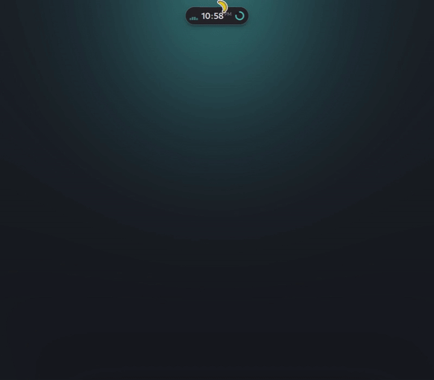

## What Pill is

Pill is a complete desktop shell that lives in a single pill. At rest it is a compact bar: a music visualiser, the clock, and a status widget you pick. Hover it and it expands into now-playing with album art, the eyes, the date, and a status tray. Click an element — or call it over IPC — and it morphs into a full panel. The transition *is* the interface: there is no second bar, no dock, no separate settings window.

It owns the pieces a desktop shell normally needs:

- the bar/island and its auto-hide hot zone
- a notification daemon (D-Bus: urgency, actions, images, expiry)
- volume/brightness OSD
- a 25-page settings workspace
- a session lock screen, plus an optional SDDM greeter theme
- the theming pipeline: wallust palettes into the shell, GTK/Qt apps, kitty, btop and fastfetch

It never manages your compositor config. Your Hyprland config starts it and consumes it over IPC — see [Use](#use).

## What it does

### The island

Every view is a state of the same surface. `pill open <state>` (or a click/keybind) switches to it; Escape or a click outside closes it.

| State | What it is |
|---|---|
| `idle` | The pill itself — collapsed at rest, expands on hover |
| `launcher` | Application search and launch |
| `notifications` | Incoming notification, and the notification list |
| `controlcenter` | Toggles, sliders, system stats, notification history |
| `settings` | The whole settings workspace (25 pages) |
| `wallpaper` | Cover-flow wallpaper library: images, GIFs, videos |
| `theme` | Theme picker with live palette swatches |
| `mediaplayer` | Album art + transport controls |
| `clipboard` | Clipboard history with copy |
| `session` | Lock, logout, suspend, reboot, shutdown |
| `capture` | Screenshot and screen-recording controls |
| `navigation` | Workspace-change OSD |
| `connectivity` | Wi-Fi and Bluetooth device selection |
| `audiodevice` | Output/input device selection |
| `volume`, `brightness` | OSDs |
| `lockscreen` | Session lock surface |
| `auth` | Polkit authentication prompt |

At rest and on hover:

| Rest | Hover |
|---|---|
|  | 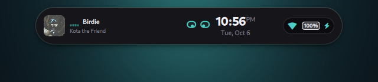 |

Both are configurable: pick the status widget next to the clock (RAM, CPU, disk, battery, volume, brightness, network — or none) and choose whether a playing track shows **cava bars**, the **dancing face**, or **both**.

### Eyes

The robot face is the shell's identity: it has moods (idle, active, alert, error), reacts to notifications, chargers, recordings and workspace switches, follows your cursor while you move it, and sleeps when you are away. It dances to whatever is playing — cava's kick detector drives the bounce, the sway and a pupil pop, everywhere a face is visible, lock screen included. Turn the groove off in **Settings → Bar → Dance to music**.

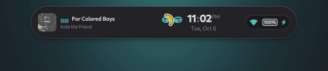

### Notifications

Pill is a full notification daemon: urgency-aware styling, app icons and images, actions, DND, expiry honoured (including `expire_timeout` enforcement that Quickshell itself leaves to the consumer), history in the control center, and `Clear all`.

| Notification | Control center |
|---|---|
| 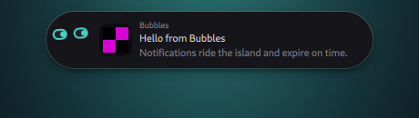 | 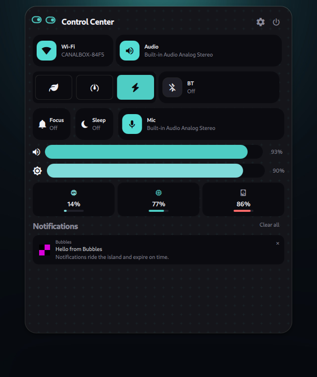 |

### Panels

The same pill becomes the launcher, the media player and the session menu:

| Launcher | Now playing |
|---|---|
| 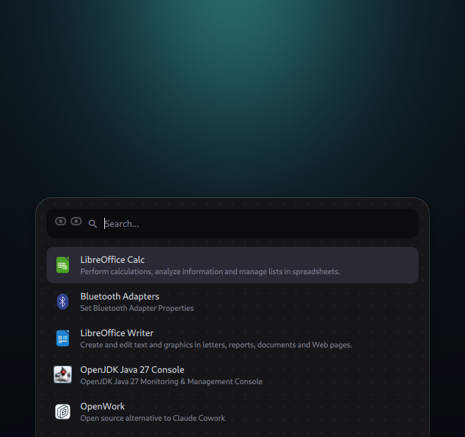 | 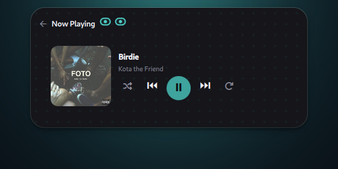 |

| Session | OSD |
|---|---|
| 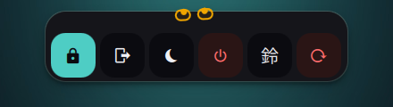 | 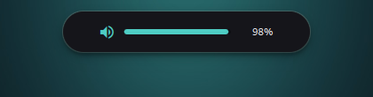 |

### Settings

A 25-page settings workspace lives inside the island: sidebar with sections, search with jumps, live mocks, and controls in the shell's own design language. Everything is applied as you change it — no save button.

| Bar & Eyes | Theme |
|---|---|
| 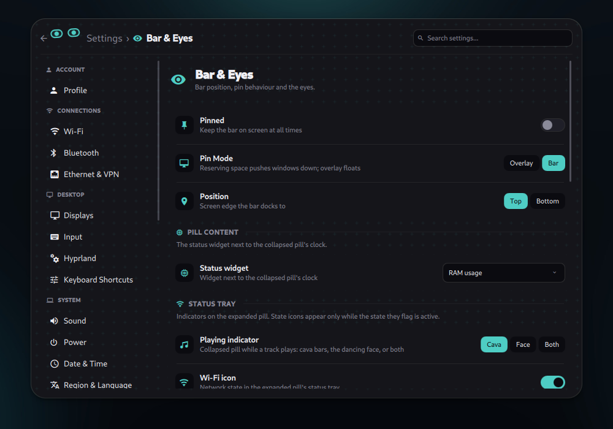 | 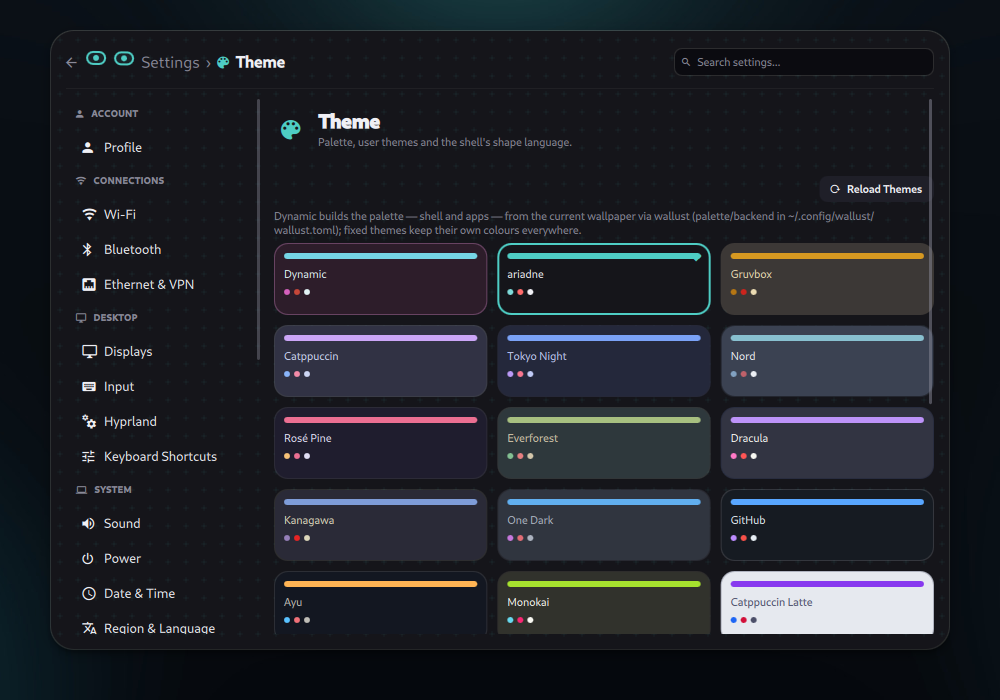 |

### Theming

Pick one of the **18 built-in themes** — ariadne, Gruvbox, Catppuccin, Tokyo Night, Nord, Rosé Pine, Everforest, Dracula, Kanagawa, One Dark, GitHub, Ayu, Monokai, Catppuccin Latte, Gruvbox Light, Sharp, Paper, Oblique — or **Dynamic**, which derives the whole palette from the current wallpaper via wallust. Fixed themes keep their own colours everywhere; only Dynamic follows the wallpaper.

| Theme picker | Wallpaper library |
|---|---|
| 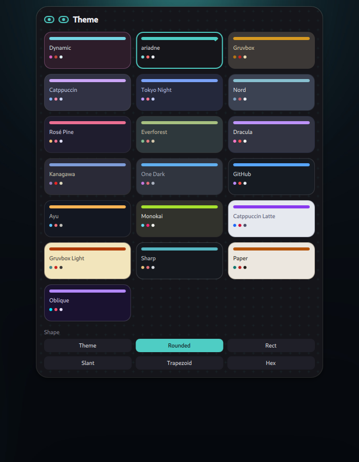 | 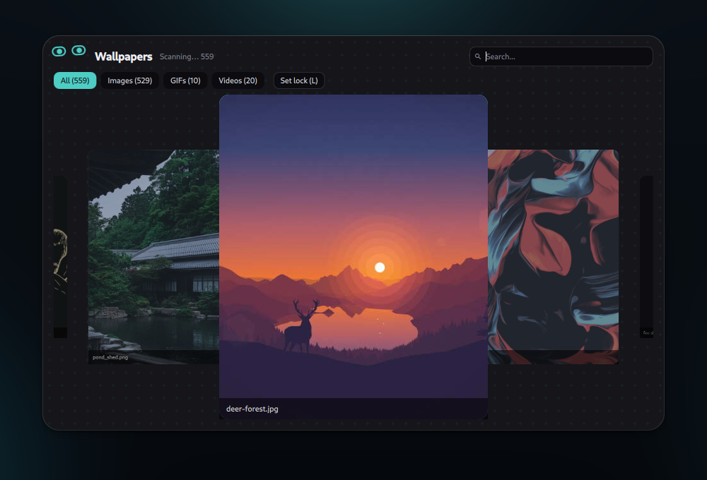 |

The palette is pushed to the rest of the system on every theme change:

- **GTK 3/4** (`gtk.css` marker block) and **Qt6ct** colour scheme, plus the GNOME `color-scheme` hint
- **wallust templates** — kitty, btop and anything else your `~/.config/wallust/wallust.toml` lists; app templates are rendered through a readability pass so dark wallpapers never make terminals too dark
- **fastfetch** — `config.jsonc` is generated from the palette with a module picker, key-label styles and an auto-fitting key column
- **lock screen + SDDM greeter** — the lock surface and an optional greeter theme snapshot the resolved palette

Custom themes are a JSON file: drop one in `~/.config/pill/themes/<name>.json`. See [`theming/README.md`](theming/README.md) for the palette mapping, the wallust lane and how to add app templates.

## Requirements

- A Wayland compositor with `wlr-layer-shell`. **Hyprland** is the tested one; the workspace OSD and the Hyprland settings page are Hyprland-only, everything else degrades gracefully.
- [Quickshell](https://quickshell.org) ≥ 0.2 — upstream (e.g. `quickshell` from the Arch repos) or the CachyOS `noctalia-qs` fork; CI smoke-tests both — plus the Qt 5 compat module (`qt6-5compat`) and `jq`: settings persistence, device lists and custom-theme reads go through it. Every tool below only disables its own feature when missing.
- Shell features: `cava` (visualizer), `playerctl` (media), `wallust` (dynamic theming + app retinting), `gsettings` (dark/light hint, cursor page).
- System: `brightnessctl`, NetworkManager (`nmcli`), PulseAudio or PipeWire (`pactl`), `rfkill` (Bluetooth radio).
- Wallpapers: `awww`, `imagemagick`, `ffmpeg`/`ffmpegthumbnailer` (video thumbs; `mpvpaper` for video wallpapers).
- Capture: `grim`, `slurp`, `wf-recorder`, `wl-clipboard`, `cliphist` (history; `satty`/`swappy` to annotate).
- Settings pages: `timedatectl`, `localectl`, `xdg-mime`, `gdbus`/`getent`/`pkexec` (+`useradd`/`userdel`). One terminal emulator (`kitty`/`foot`/`alacritty`) is only needed for changing passwords from Settings → Accounts.
- Optional: `fastfetch`, `powerprofilesctl`, `blueman`, `nm-connection-editor`, `hypridle`/`swayidle`, `sddm`.

`pill doctor` prints the same tiers: only `quickshell` and `jq` fail the check.

## Install

### Arch Linux

```bash
git clone https://github.com/gr1nch3/pill
cd pill
makepkg -si
```

The package installs the shell to `/etc/xdg/quickshell/pill` and the `pill` CLI to `/usr/bin/pill`.

### Nix

```bash
nix run github:gr1nch3/pill     # starts the shell
```

With the home-manager module, the shell config lands in `~/.config/quickshell/pill` and the `pill` CLI is installed — start it from your compositor as usual (`qs -c pill -d` in the snippet below):

```nix
{
  inputs.pill.url = "github:gr1nch3/pill";
  # ...
  programs.pill.enable = true;
}
```

### From source

```bash
git clone https://github.com/gr1nch3/pill
cd pill

# Quickshell discovers configs as ~/.config/quickshell/<name>/shell.qml
ln -s "$PWD/shell" ~/.config/quickshell/pill
qs -c pill -d
```

### wallust templates

Pill runs **your** wallust config. Copy the reference so terminals follow the theme:

```bash
mkdir -p ~/.config/wallust/templates
cp theming/wallust/wallust.toml ~/.config/wallust/wallust.toml
cp theming/wallust/templates/* ~/.config/wallust/templates/
```

Merge instead of clobbering if you already have a config. `pill doctor` reports how many templates it found, and **Settings → Integrations → Re-apply** re-renders them on demand.

## Use

### Start it

```bash
qs -c pill -d     # start (or add it to your compositor autostart)
pill reload       # restart after an update
pill doctor       # check every tool it needs
```

### Hyprland (consumer-side)

Pill ships no compositor config — wire it into your own `hyprland.conf`:

```ini
exec-once = qs -c pill -d

$pill = qs -c pill ipc call pill

bind = SUPER, A, exec, $pill open launcher
bind = SUPER, T, exec, $pill open settings theme
bind = SUPER SHIFT, W, exec, $pill open wallpaper
bind = SUPER, V, exec, $pill open clipboard
bind = SUPER ALT, L, exec, $pill lockScreen

# Volume/brightness: system commands so the Pill OSD still pops up
binde = , XF86AudioRaiseVolume, exec, pactl set-sink-volume @DEFAULT_SINK@ +5%
binde = , XF86AudioLowerVolume, exec, pactl set-sink-volume @DEFAULT_SINK@ -5%
binde = , XF86AudioMute, exec, pactl set-sink-mute @DEFAULT_SINK@ toggle
```

### IPC

One generic call opens any state; the optional second argument is a settings page id or a device-select type. If you installed the package, the `pill` CLI forwards anything that is not a management subcommand:

```bash
pill open launcher                  # or: qs -c pill ipc call pill open launcher
pill open settings theme
pill open wifi                      # or: bluetooth
pill open mic                       # or: audio
pill setTheme nord
pill setWallpaper ~/Pictures/Wallpapers/deer.jpg
pill volumeUp                       # volumeDown | volumeMute
pill brightnessUp                   # brightnessDown
pill lockScreen
pill close
```

### Settings

Open it from the control center's gear, or `pill open settings [page]`. Pages are grouped as Account / Connections / Desktop / System / Appearance / Shell / About, and everything applies live. Notable pages:

- **Bar & Eyes** — position, pin mode, the pill's status widget, the status tray toggles, eyes on/off, dance to music
- **Theme** — the theme picker, shape language, user themes
- **Backgrounds** — panel patterns, lock/sign-in wallpaper and pattern
- **Notifications** — DND, timeout, history size, sounds
- **Integrations** — tool checks, system-theme sync, wallust re-apply

### Themes

```bash
pill theme catppuccin    # or: gruvbox, tokyonight, nord, rosepine, everforest,
                            # dracula, kanagawa, onedark, github, ayu, monokai,
                            # latte, gruvbox-light, sharp, paper, oblique, dynamic
```

User themes: drop a JSON file into `~/.config/pill/themes/<name>.json` (a user theme with the same name replaces a built-in). The format and the full palette contract are in [`theming/README.md`](theming/README.md).

### Configuration

Settings persist to `~/.config/pill/config.json`. Everything is editable from the UI; the file is there when you want to script it. A few keys worth knowing:

| Key | Meaning |
|---|---|
| `position` | `top` or `bottom` |
| `pinned`, `pinMode` | Always-visible, and whether the bar reserves space (`bar`) or floats (`overlay`) |
| `idleMonitor` | Collapsed pill widget: `ram`, `cpu`, `disk`, `battery`, `volume`, `brightness`, `network`, `none` |
| `idlePlaying` | Playing indicator: `cava`, `face`, `both` |
| `tray*` | Which icons ride the expanded pill (`trayWifi`, `trayBluetooth`, `trayBattery`, `trayDnd`, `trayAudio`, `trayMic`, `trayRecording`) |
| `eyesEnabled`, `eyesDance`, `eyeVariant` | The face: visibility, music groove, expression |
| `patternStyle`, `patternDensity` | Panel background patterns |
| `syncSystemTheme` | Mirror the palette into GTK/Qt/gsettings |
| `fastfetch*` | fastfetch theming: logo, modules, key labels |
| `autoHideDelay`, `showDelay`, `notificationTimeout`, `osdTimeout` | Timing |
| `session*` | Lock/logout/suspend/reboot/shutdown commands (compositor-neutral defaults) |

## Layout

```
pill/
├── shell/            # Quickshell config (qs -c pill)
│   ├── shell.qml     # Entry point: hot zone, IPC, notifications, lock
│   ├── IslandPill.qml
│   ├── states/       # One file per island state
│   ├── components/   # Shared UI + singletons (Theme, IslandState)
│   ├── services/     # Data providers (Config, Audio, Network, Cava, ...)
│   ├── settings/     # Settings workspace (pages/, controls/)
│   ├── bar/          # HotZone (auto-hide strip)
│   ├── utils/        # Command/Store wrappers, theme + arrange helpers
│   ├── eyes/         # Eye.qml — shared identity, Quickshell-free
│   └── assets/pam.d/ # PAM config for lockscreen auth
├── sddm-theme/       # SDDM greeter theme (copies Eye.qml at package time)
├── theming/          # wallust reference config/templates + pipeline docs
├── bin/pill       # CLI: reload / doctor / theme / greeter / update / rollback
├── nix/              # Flake derivation + home-manager module
├── assets/           # README media
└── PKGBUILD
```

## Docs

- [`theming/README.md`](theming/README.md) — theme lanes, the wallust → palette mapping, app templates, greeter pipeline

## Credits

Pill stands on [Quickshell](https://quickshell.org) by outfoxxed and the Wayland ecosystem around it: [wallust](https://codeberg.org/explosion-mental/wallust), [awww](https://codeberg.org/LGFae/awww), [cava](https://github.com/karlstav/cava), [playerctl](https://github.com/altdesktop/playerctl), [wf-recorder](https://github.com/ammen99/wf-recorder), plus the Arch/CachyOS community. The face owes its personality to everyone who ever put eyes on a terminal.

## License

MIT — see [`LICENSE`](LICENSE).
